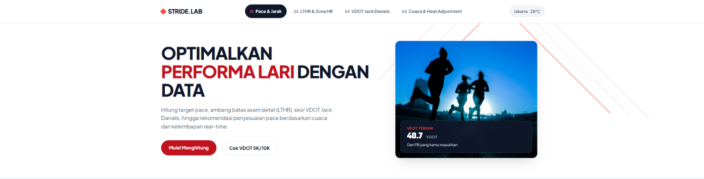
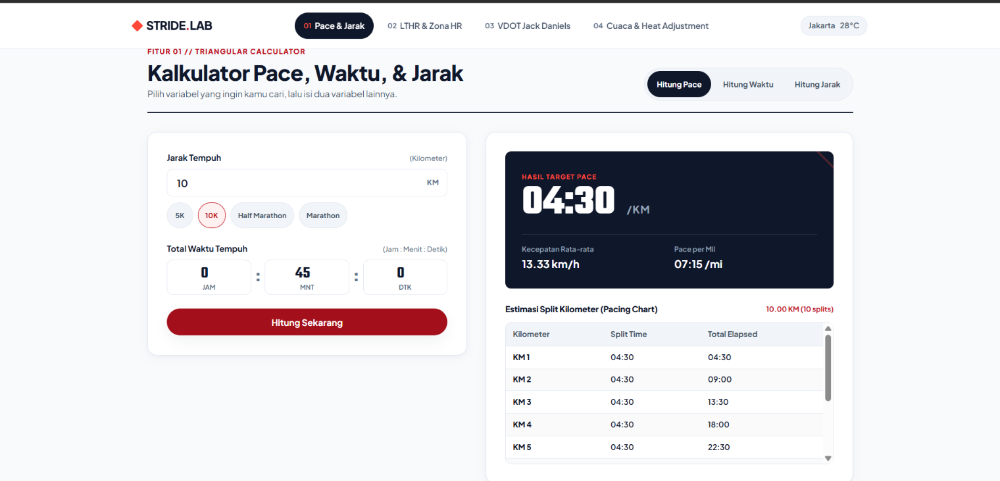
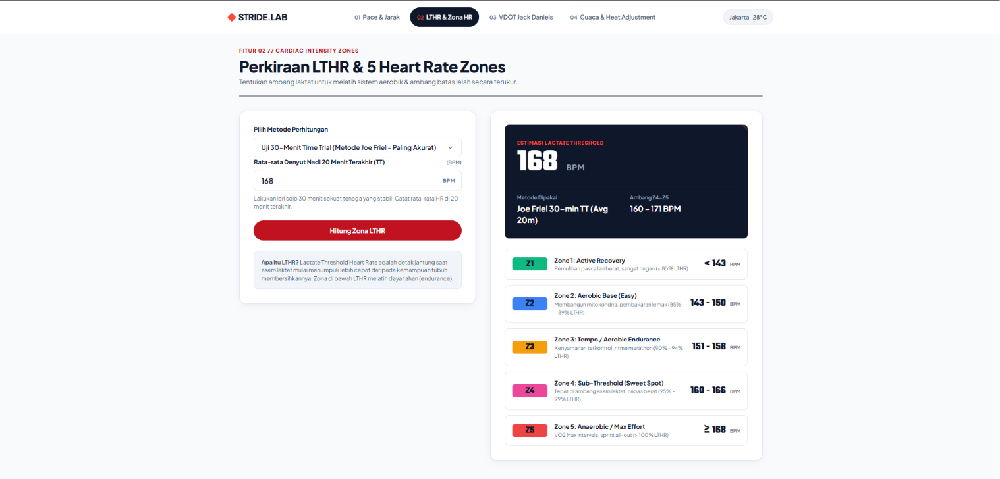
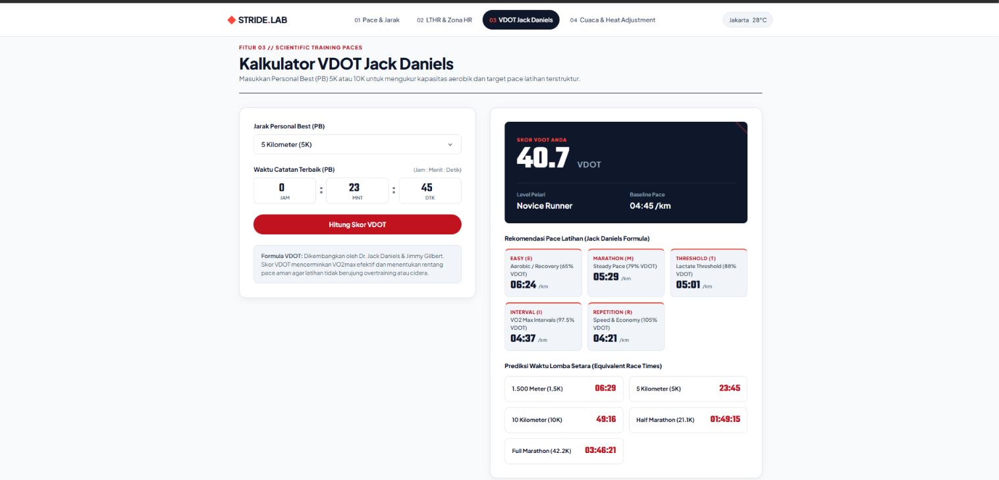
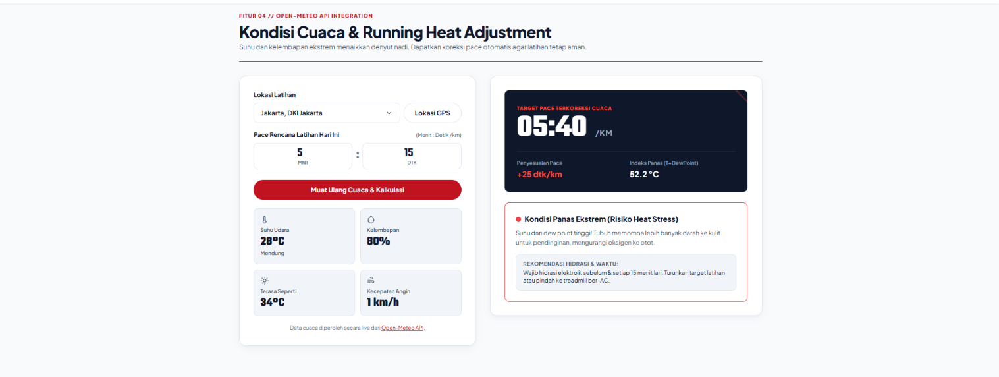

# STRIDE // Running Performance & VDOT Lab

Website statis untuk membantu pelari menghitung pace, waktu tempuh, jarak, ambang batas laktat (LTHR), zona detak jantung, skor VDOT Jack Daniels, dan penyesuaian pace berdasarkan cuaca real-time.

## Fitur

### 1. Kalkulator Pace, Waktu, dan Jarak
- Hitung salah satu variabel: pace, waktu, atau jarak.
- Preset jarak 5K, 10K, dan half marathon.
- Tabel split otomatis per kilometer.
- Konversi kecepatan ke km/h dan pace per mil.

### 2. LTHR dan Zona Detak Jantung
- Tiga metode input: Joe Friel 30 menit, persentase HR Max, dan formula Gellish.
- Pembagian 5 zona latihan: recovery, aerobic base, tempo, sub-threshold, dan anaerobic.
- Rentang BPM setiap zona dihitung dari nilai LTHR.

### 3. VDOT Jack Daniels
- Skor VDOT dari waktu lomba 5K, 10K, half marathon, atau full marathon.
- Pace latihan E, M, T, I, dan R.
- Prediksi waktu lomba untuk jarak 1.500 m sampai maraton.

### 4. Cuaca dan Heat Adjustment
- Data suhu, kelembapan, suhu terasa, kecepatan angin, dan kondisi cuaca dari Open-Meteo.
- Pilih kota atau gunakan lokasi GPS.
- Cache 10 menit, timeout 8 detik, dan tombol coba lagi saat koneksi gagal.
- Rekomendasi pace terkoreksi berdasarkan panas dan kelembapan.

### 5. Aksesibilitas dan Responsivitas
- Navigasi tab bisa memakai tombol panah, Home, dan End.
- Label ARIA, skip link, dan fokus keyboard.
- Layout menyesuaikan layar ponsel sampai desktop.

## Teknologi

- HTML
- CSS
- JavaScript , seluruh logika ada di satu file `script.js`
- [Open-Meteo API](https://open-meteo.com/) untuk data cuaca


## Struktur Proyek

```text
.
├── index.html
├── style.css
├── script.js
├── favicon.svg
├── hero-runner.jpg
├── screenshots/
│   └── .gitkeep
├── .gitignore
└── README.md
```

## Menjalankan Proyek

Cara paling cepat, buka `index.html` langsung di browser.

Jika ingin memakai server lokal:

```bash
python -m http.server 8000
```

Lalu buka `http://localhost:8000`.

Catatan: fitur cuaca dan font Google membutuhkan koneksi internet. Open-Meteo tidak memerlukan API key.


## Screenshot Tampilan

| No | Tampilan | Nama File | Preview |
|----|----------|-----------|---------|
| 1 | Hero dan Navbar | `01-hero.png` |  |
| 2 | Kalkulator Pace, Waktu, dan Jarak | `02-pace.png` |  |
| 3 | LTHR dan Zona Detak Jantung | `03-lthr.png` |  |
| 4 | VDOT dan Training Paces | `04-vdot.png` |  |
| 5 | Cuaca dan Heat Adjustment | `05-cuaca.png` |  |

